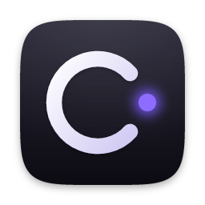
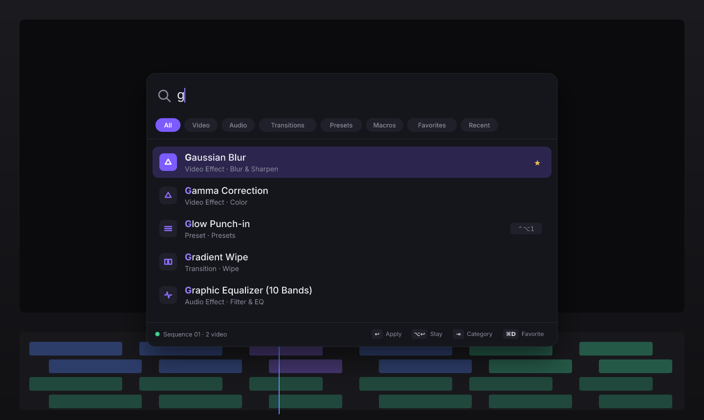

<div align="center">



# Cue

**A free, open-source keyboard command bar for Adobe Premiere Pro, built exclusively for macOS.**
Search and apply effects, transitions, presets and macros without digging through panels.

[](https://github.com/Yasmawi/Cue/releases)


[](https://github.com/Yasmawi/Cue/releases)
[](https://github.com/Yasmawi/Cue/actions/workflows/ci.yml)
[](LICENSE)



</div>

---

## 🍎 Why Cue?

Excalibur-style command palettes make editing faster, but most free ones are Windows-only. Cue is a **native Mac app** (Swift and SwiftUI, no Electron, no Python) that lives in your menu bar, opens instantly over Premiere, and pairs with a small UXP plugin inside Premiere.

## ✨ Features

- ⌨️ **Floating search bar.** Press ⌥Space over Premiere. Premiere stays active, so your clip selection isn't lost.
- 🔎 **Fuzzy search** across video effects, audio effects, transitions, presets and macros (`gb` finds Gaussian Blur).
- 🗂️ **Keyboard categories.** Use Tab, ⌘1–8 or prefixes like `t:` and `p:`.
- ⚡ **Apply instantly.** ↩ to apply and close, ⌥↩ to keep stacking. Works on the selected clips, or the clip under the playhead.
- 🎛️ **Keyframe-safe presets.** Capture a styled clip once and apply it anywhere. Effects are added as new copies, your existing keyframes are left untouched, and timing adapts to each clip.
- 🔗 **Macros.** Chain effects, presets, transitions and pauses into one action.
- ⭐ **Favorites, recents and custom shortcuts.** Bind any item to its own hotkey. Shortcuts only work while Premiere is in front.
- 🎨 **Themes.** Five themes, custom accent color, translucency, size and density options.
- 🔌 **Live sync.** A small UXP plugin keeps Cue's list in step with every effect installed in Premiere.

## 📦 Install

### Requirements
- macOS 13 Ventura or later
- Adobe Premiere Pro **25.6 or later**
- The Creative Cloud desktop app, needed once to install the plugin

### 1. The Mac app
Download `Cue.zip` from [Releases](https://github.com/Yasmawi/Cue/releases), unzip it, and move **Cue.app** to Applications.

> The app isn't notarized. If macOS says it's damaged or can't be opened, run this once:
> ```bash
> xattr -dr com.apple.quarantine /Applications/Cue.app
> ```

**Or build from source** (needs Xcode or the Command Line Tools):
```bash
git clone https://github.com/Yasmawi/Cue.git
cd Cue/app && ./build.sh --install
```

### 2. The Premiere plugin
1. Download `CueBridge.ccx` from [Releases](https://github.com/Yasmawi/Cue/releases), or build it with `plugin/make-ccx.sh`.
2. Double-click it and click **Install** in Creative Cloud.
3. In Premiere: **Window › UXP Plugins › Cue Bridge**, then dock the panel.

### 3. Connect
Copy the pairing code from Cue's menu-bar icon (the Cue mark: the C with a dot), paste it into the Cue Bridge panel, and click **Connect**.

## 🚀 Getting started

| Key | Action |
|---|---|
| ⌥Space | open or close Cue |
| ↑ ↓ | move through results |
| ⇥ / ⌘1–8 | switch category |
| ↩ / ⌥↩ | apply / apply and keep open |
| ⌘D | favorite |
| ⎋ | clear / close |

**Presets:** style a clip, select it and click **Capture** in the Cue Bridge panel. The preset then shows up in search.

📖 The **[full guide](docs/GUIDE.md)** covers presets, macros, shortcuts, every setting, how the bridge works, and troubleshooting.

## 🛣️ Roadmap & known limits
See [ROADMAP.md](ROADMAP.md). Limits imposed by Premiere's plugin API:
- Audio transitions can't be applied by UXP plugins.
- Native `.prfpset` presets can't be applied directly. Capture a clip instead.
- Keyframe ease curves aren't exposed. Interpolation modes are kept.

## 🧱 Tech stack

| Part | Built with |
|---|---|
| Mac app | Swift, SwiftUI + AppKit, Network.framework (WebSocket server), Carbon hotkeys. No dependencies. |
| Premiere plugin | UXP (JavaScript), Premiere DOM API |
| Link | Local WebSocket on `localhost:47821`, pairing-code auth |

```
app/      Swift package for the macOS app
plugin/   Cue Bridge UXP plugin and its tests
docs/     guide, logo, screenshots
```

### Development
```bash
cd plugin && npm install && npm test   # plugin logic + protocol tests
cd app && swift build                  # build the app
```

## 🙏 Acknowledgements
Inspired by command-palette tools for Premiere such as Excalibur and [Premiere Companion](https://github.com/BlessEphraem/Premiere-Companion). On Windows, check out Premiere Companion.

## 📄 License
Copyright © 2026 Yasmawi. Licensed under [GPL-3.0](LICENSE): free to use, study, modify and share. Modified versions you distribute must stay open source under the same license.
